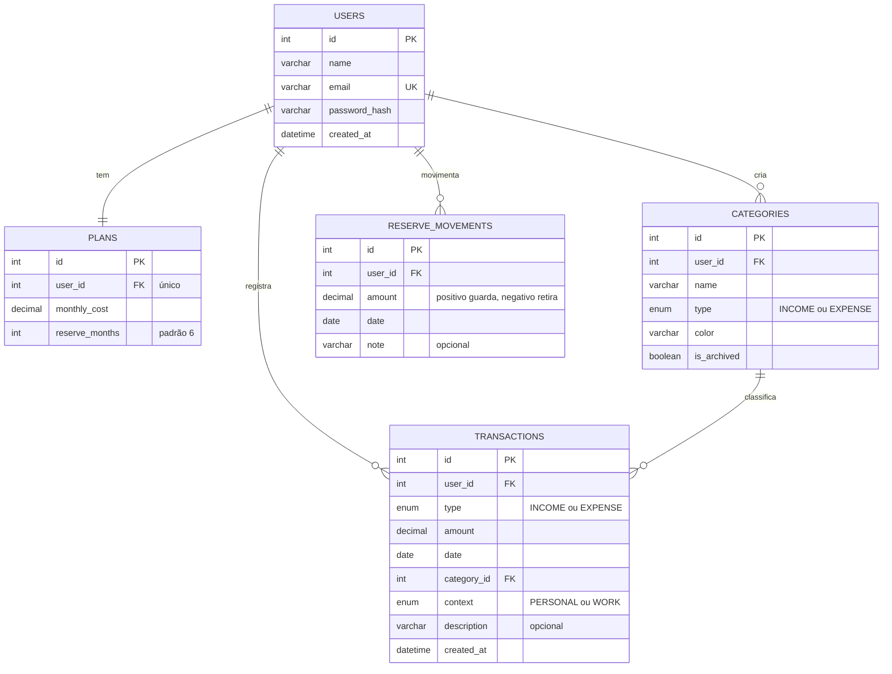

# FinIA

> Controle financeiro para quem tem **renda variável**, com assistente de IA.

🚧 **Em desenvolvimento** · fase atual: planejamento

## O problema

Autônomos, freelancers, MEIs, motoristas e entregadores de aplicativo recebem valores diferentes a cada mês. Os apps de finanças, inclusive os dos bancos, partem de um salário fixo e não ajudam esse público a planejar.

Os dados públicos confirmam o problema:

- Cerca de **2 milhões** de pessoas trabalham por aplicativo no Brasil, com média de 44,7 horas por semana ([IBGE, 2025](https://movimentoeconomico.com.br/trabalho/2026/09/04/trabalhadores-por-app-chegam-a-2-milhoes-mas-dois-tercos-nao-tem-previdencia/)).
- **31%** dos brasileiros não têm nenhuma reserva financeira; nas classes D e E, são 48% ([Anbima/Datafolha, 2025](https://investalk.bb.com.br/noticias/mercado/3-em-cada-10-brasileiros-nao-tem-reserva-financeira-mostra-raio-x-da-anbima)).
- Especialistas recomendam que autônomos tenham reserva de **6 a 12 meses** de gastos e separem o dinheiro pessoal do dinheiro do trabalho ([fonte](https://paraibabusiness.com.br/trabalho-autonomo-cresce-no-brasil-e-exige-planejamento-financeiro-para-lidar-com-renda-variavel/)).

## A solução

O FinIA transforma uma renda irregular em um plano previsível.

- **Salário inteligente:** quanto você pode se pagar por mês com segurança, calculado a partir do seu histórico de entradas.
- **Quanto posso gastar hoje:** um único número na tela inicial, recalculado todo dia.
- **Reserva para meses fracos:** meta medida em meses de custo de vida, com barra de progresso.
- **Pessoal e trabalho separados** em cada lançamento.
- **Assistente de IA** que responde perguntas em português, como "qual foi meu pior mês?".

## Telas

| Tela | O que responde |
| --- | --- |
| Cadastro e Login | Como criar a conta e entrar |
| Meu plano | Quanto preciso por mês e quantos meses de reserva quero |
| Início | Quanto posso gastar hoje, quanto posso me pagar e como está a reserva |
| Lançamentos | O que entrou e o que saiu, com filtros |
| Categorias | Como organizo meus gastos e entradas |
| Reserva | Quanto já guardei e quanto falta |
| Assistente | Perguntas em português sobre o meu dinheiro |

Fluxo do primeiro acesso: **Cadastro → Meu plano → primeiro lançamento → Início**.

## Tecnologias

| Parte | Tecnologia |
| --- | --- |
| Front-end | React, Vite, Tailwind CSS, Recharts |
| Back-end | Node.js, Express, Zod |
| Banco de dados | MySQL com Prisma |
| Autenticação | JWT e bcrypt |
| IA | Gemini API (function calling) |
| Qualidade | Vitest, Supertest, GitHub Actions |
| Hospedagem | Vercel, Render e Aiven |

## Arquitetura

As telas e a IA conversam apenas com a API, e só a API acessa o banco de dados. A IA nunca consulta o banco diretamente: ela pede à API funções prontas, que retornam apenas os dados do usuário logado.

```
Telas (React)  ──HTTP──▶  API (Node.js + Express)  ──Prisma──▶  MySQL
                               ▲        │
                 pede uma função│        │envia a pergunta
                               │        ▼
                            Gemini API (IA)
```

## Modelo de dados



Decisões de modelagem:

- **Dinheiro em `DECIMAL`, nunca `FLOAT`**, para evitar erros de arredondamento.
- **O saldo da reserva não é armazenado:** é a soma dos movimentos, então nunca fica desatualizado.
- **Uma categoria com lançamentos não pode ser excluída** (`ON DELETE RESTRICT`). O usuário pode mover os lançamentos para outra categoria ou arquivar a categoria (soft delete), sem perder histórico.
- **Quase toda tabela tem `user_id`**, o que garante que cada pessoa veja apenas os próprios dados.

## Rotas da API

| Verbo e rota | O que faz |
| --- | --- |
| `POST /auth/register` | Cria uma conta |
| `POST /auth/login` | Faz login e devolve um token JWT |
| `GET /plan` · `PUT /plan` | Busca e atualiza o plano |
| `GET /categories` · `POST /categories` | Lista e cria categorias |
| `PUT /categories/:id` · `DELETE /categories/:id` | Edita e exclui (responde 409 se houver lançamentos) |
| `PATCH /categories/:id/archive` | Arquiva uma categoria |
| `GET /transactions?month=2026-10` | Lista lançamentos do mês, com filtros |
| `POST /transactions` | Cria um lançamento |
| `PUT /transactions/:id` · `DELETE /transactions/:id` | Edita e exclui um lançamento |
| `GET /reserve` · `POST /reserve/movements` | Saldo e progresso da reserva; guardar ou retirar |
| `GET /dashboard?month=2026-10` | Dados da tela inicial |
| `POST /assistant` | Envia uma pergunta ao assistente |

## Roadmap

- [x] Fase 0 — Ambiente e repositório
- [x] Fase 1 — Planejamento (validação, telas, banco de dados e rotas)
- [ ] Fase 2 — API e banco de dados
- [ ] Fase 3 — Login e segurança
- [ ] Fase 4 — Telas
- [ ] Fase 5 — Dashboard e salário inteligente
- [ ] Fase 6 — Assistente de IA
- [ ] Fase 7 — Testes, CI e documentação
- [ ] Fase 8 — Deploy

**Ideias para a versão 2:** lançar gastos por mensagem (Telegram), "quanto você ganha por hora de verdade" (já descontados custos como gasolina), lembrete do INSS ou do DAS do MEI e importação de extrato em CSV.

## Autor

**Rafael William**, estudante de Engenharia de Software no UniCEUB · [LinkedIn](https://www.linkedin.com/in/rafael-william-5190b33a8/) · [GitHub](https://github.com/RafaelWilliam2808)

Distribuído sob a licença MIT.
